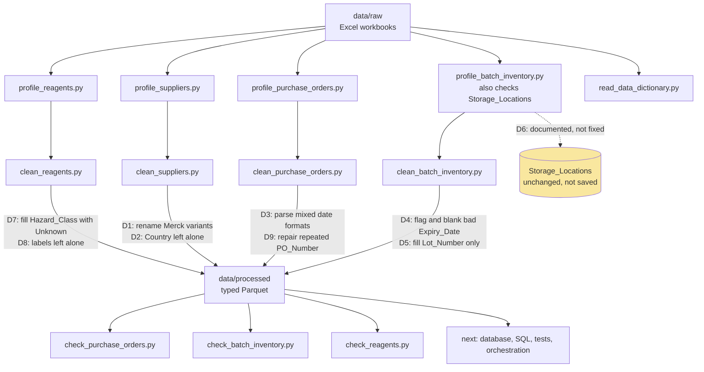

# pharma-data-pipeline

A learning project that builds a data pipeline for a pharmaceutical reagent inventory and waste dataset.

The data is **synthetic, but it is based on real-world data**. Real data could not be used for confidentiality reasons. The profiling and cleaning steps address the data quality problems found in it. The Excel files stay in `data/raw` and are never pushed to GitHub.

## Purpose

This project supports a study of why so much reagent stock is wasted in a pharmaceutical laboratory, and what could reduce it. Possible causes include expired reagents and contamination, and possible improvements are in how reagents are ordered and stored. The wider aim is a process where chemicals are ordered on time, stored correctly, tracked from order to use and available when needed, with as little waste as possible.

The pipeline cleans and validates the ordering, receiving, inventory and waste records so that analysis of these questions can be trusted. Where records disagree, for example waste cost, batch status and expiry dates, the disagreement is itself a finding about tracking. These findings are recorded in `docs/decisions.md`.

## Status

| Table | Profiled | Cleaned | Decisions |
|---|---|---|---|
| Suppliers | Yes | Yes | D1, D2 |
| Purchase_Orders | Yes | Yes | D3, D9 |
| Batch_Inventory | Yes | Yes | D4, D5 |
| Storage_Locations | Yes | Not changed | D6 |
| Reagents | Partly | Yes | D7, D8 |

## Data flow

## Decisions

The full reasoning and evidence for each decision is in `docs/decisions.md`.

| ID | Table | Decision |
|---|---|---|
| D1 | Suppliers | Rename Merck, Merck SA and MERCK to Merck |
| D2 | Suppliers | Supplier_ID and Country look inconsistent. Documented, Country left unchanged |
| D3 | Purchase_Orders | Read Order_Date in three formats, slash dates as day/month/year |
| D4 | Batch_Inventory | Blank the 14 bad Expiry_Date values and flag them |
| D5 | Batch_Inventory | Fill missing Lot_Number with Unknown, leave missing Storage_Location |
| D6 | Storage_Locations | Storage_Type and Temperature_Range do not match. Documented, not fixed |
| D7 | Reagents | Fill missing Hazard_Class with Unknown |
| D8 | Reagents | Some Hazard_Class labels look implausible. Documented, not fixed |
   | D9 | Purchase_Orders | Repair 17 repeated PO000123 numbers by row position and keep the original value |
   | D10 | Receipts and Batches | Order-to-receipt dates and the batch-to-order reagent link are unreliable. Documented, not fixed |

## Project layout

- `data/raw` holds the original Excel files, which are never edited or committed
- `data/processed` holds the cleaned Parquet files, which are not committed
- `src` holds the profile, clean and check scripts
- `docs/decisions.md` holds the decision record

## Running it

1. Install [uv](https://docs.astral.sh/uv/) and run `uv sync`
2. Put the two Excel files in `data/raw`
3. Run a script from the project root, for example `uv run python src/clean_suppliers.py`
