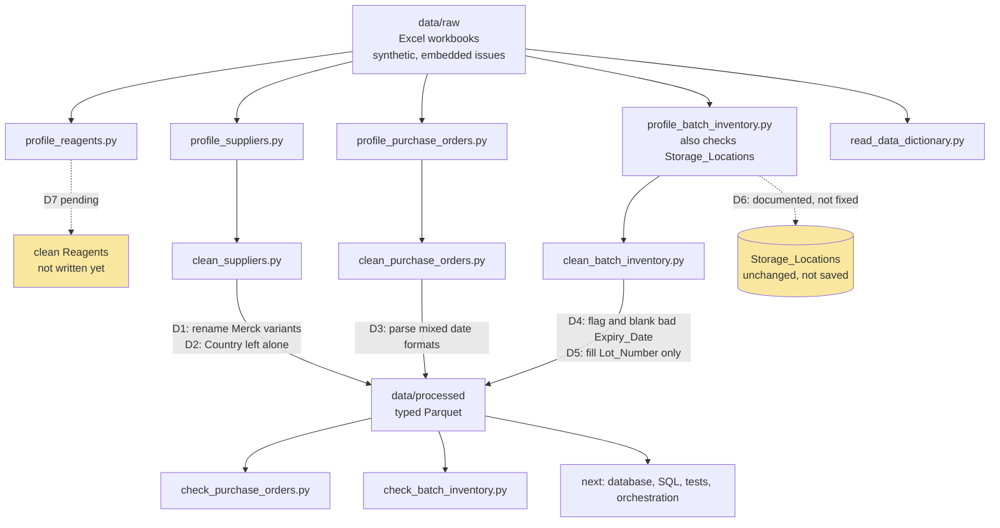

# pharma-data-pipeline

A learning project that builds a data pipeline for a pharmaceutical reagent inventory and waste dataset.

The data is **synthetic**. The workbook states it was generated with embedded quality issues, so the profiling and cleaning steps have real problems to find. The Excel files stay in `data/raw` and are never pushed to GitHub.

## Status

| Table | Profiled | Cleaned | Decisions |
|---|---|---|---|
| Suppliers | Yes | Yes | D1, D2 |
| Purchase_Orders | Yes | Yes | D3 |
| Batch_Inventory | Yes | Yes | D4, D5 |
| Storage_Locations | Yes | Not changed | D6 |
| Reagents | Yes | Not yet | D7 pending |

## Data flow

## Decisions

The full reasoning and evidence for each decision is in `docs/decisions.md`.

| ID | Table | Decision |
|---|---|---|
| D1 | Suppliers | Rename Merck, Merck SA and MERCK to Merck |
| D2 | Suppliers | Supplier_ID and Country look inconsistent. Documented, Country left unchanged |
| D3 | Purchase_Orders | Read Order_Date in three formats, slash dates as day/month/year |
| D4 | Batch_Inventory | Blank the 14 bad Expiry_Date values and flag them |
| D5 | Batch_Inventory | Fill missing Lot_Number with Unknown, leave missing Storage_Location |
| D6 | Storage_Locations | Storage_Type and Temperature_Range do not match. Documented, not fixed |

## Project layout

- `data/raw` holds the original Excel files, which are never edited or committed
- `data/processed` holds the cleaned Parquet files, which are not committed
- `src` holds the profile, clean and check scripts
- `docs/decisions.md` holds the decision record

## Running it

1. Install [uv](https://docs.astral.sh/uv/) and run `uv sync`
2. Put the two Excel files in `data/raw`
3. Run a script from the project root, for example `uv run python src/clean_suppliers.py`